<div align="center">

# Yap Studio

**The video editor you never have to learn.**

For people with more to say than time to edit. 30 card types. Every cut checked. No timeline.

Drop in your raw takes, stumbles and all. An agent in Claude Code cuts the dead air and the
restarts, adds your captions, cards, B-roll and music, and checks the video before you see it.
You leave notes from your phone, and the next version follows them.

<p>
<a href="https://github.com/cathrynlavery/yap-studio/stargazers"></a>
<a href="LICENSE"></a>


</p>

**[Website](https://yapstudio.app) · [Changelog](CHANGELOG.md) · [Discussions](https://github.com/cathrynlavery/yap-studio/discussions)**

</div>

<p align="center">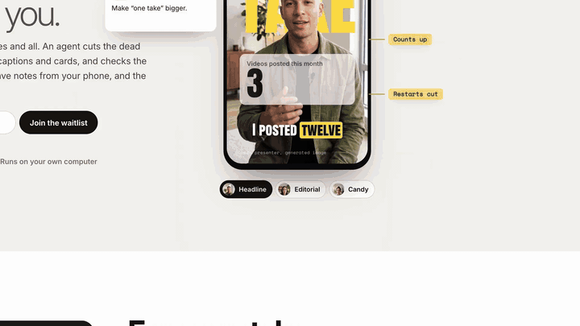</p>

<p align="center">You talk. The agent edits. You comment.</p>

<p align="center">If it saves you an evening of editing, star the repo so other creators can find it.</p>

Yap Studio is an open-source add-on for [HyperFrames](https://www.npmjs.com/package/hyperframes)
that edits vertical videos on your own computer. It is for people who talk to a camera and would
rather not spend the evening in an editor. There is no timeline to drag. A page in your browser
walks you through each video, and the notes you approve become taste rules, so the next video
starts closer to how you like it.

Your video files stay on your computer. Still frames from pinned notes and contact sheets of
your clips go to Claude (Anthropic), along with the transcript, your notes and the project files
Claude reads, as part of your Claude Code session.
ElevenLabs, WaveSpeed and Pexels get only what they need, and only if you turn them on.
Notes about problems with the tool stay on your computer until you agree to share them.

If you build software, the engine is Python with a command line. Skip to
[For developers](#for-developers).

## Three steps, then you talk

You need a Mac with macOS 14 or newer and about 10 GB free on a local disk.
Install [Claude Code](https://claude.com/product/claude-code) and sign in once with `/login`.
Claude runs setup one step at a time and asks before each install. On a Mac, it uses Homebrew
and offers to install Homebrew first if needed.

1. Download `yap-studio-workspace-<version>.zip` from the
   [latest release](https://github.com/cathrynlavery/yap-studio/releases/latest) and unzip it
   into a local folder, not a synced one.
2. Open that folder in Claude Code and say "set me up". The first setup downloads the speech
   model (about 2.5 GB) and the video renderer, then opens Yap Studio home in your browser.
3. Choose what you're making, add your footage, pick your look on a still from your own take,
   and press Make my video.

After that, you watch the story cut and then the finished video, leave notes on any moment, and
approve the version you keep. [docs/home.md](docs/home.md) explains how the page and the agent
work together.

## You talk. The agent edits. You comment.

These are real screens from a full run on synthetic footage: a photo of a generated sample
presenter with a slow push, reading a short script in the Mac's built-in voice.

<table>
<tr>
<td width="50%">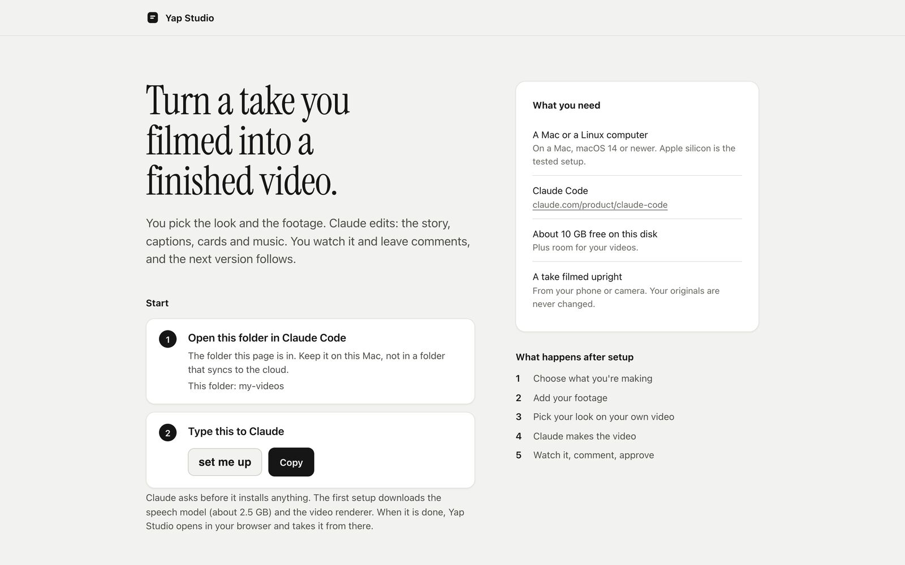<br>
<b>1. Start here.</b> The workspace opens with a page that lists what you need and the one
phrase to type in Claude Code. Claude asks before it installs anything.</td>
<td width="50%">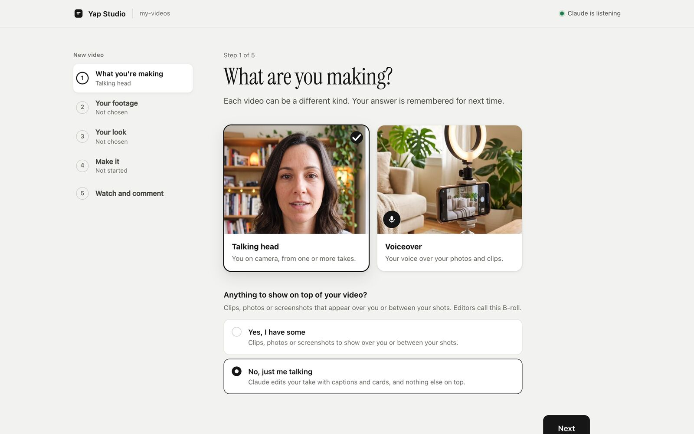<br>
<b>2. What you're making.</b> Talking head or voiceover. A talking head asks whether you have
anything to show on top before asking where it is.</td>
</tr>
<tr>
<td>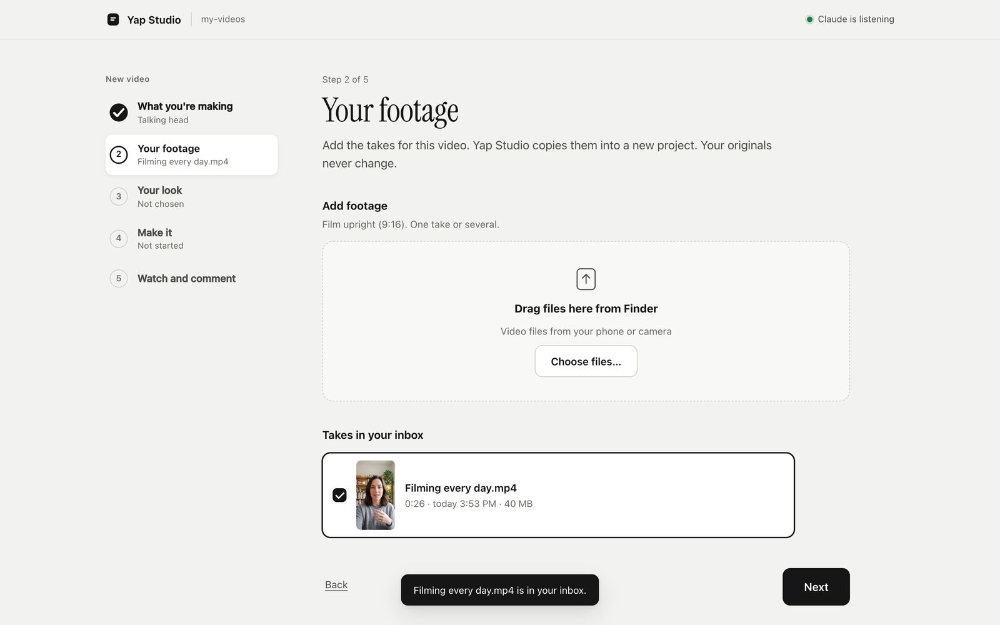<br>
<b>3. Your footage.</b> Drag takes in from Finder or choose files. Yap Studio copies them into
the inbox and never changes the originals.</td>
<td>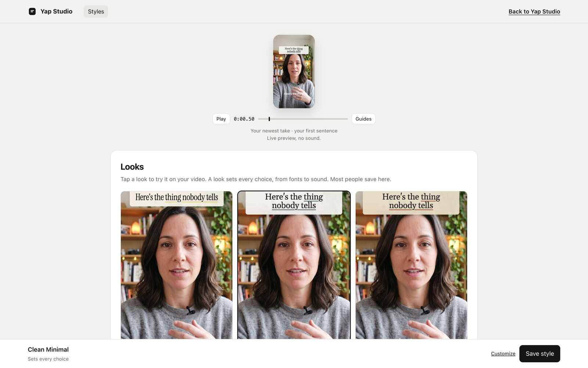<br>
<b>4. Your look.</b> Tap a look on a still from your own take, or fine-tune it.</td>
</tr>
<tr>
<td>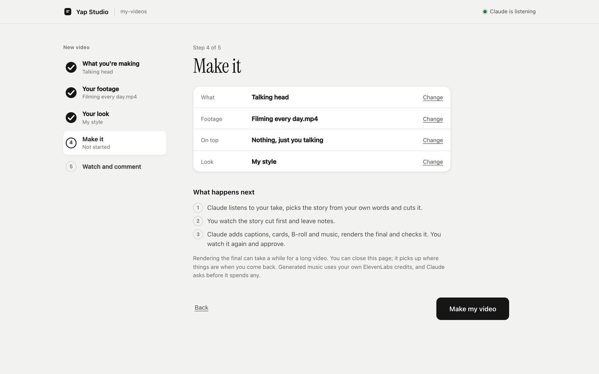<br>
<b>5. Make it.</b> Press Make my video. Claude picks it up without you typing anything.</td>
<td>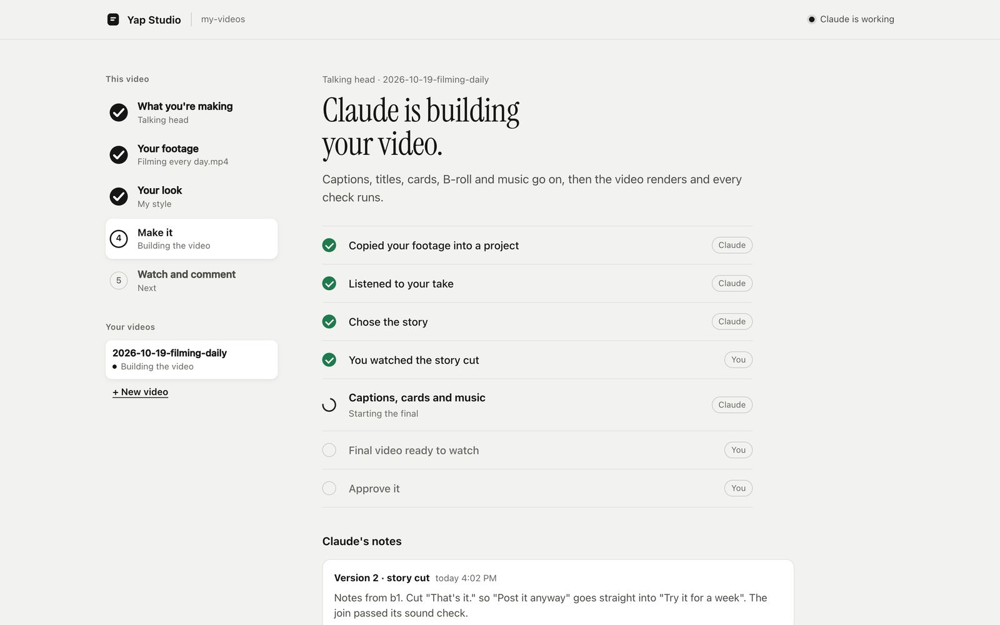<br>
<b>6. While Claude works.</b> The page shows each step as it happens. Claude's notes say what
each version changed, and you can message Claude from the page.</td>
</tr>
<tr>
<td>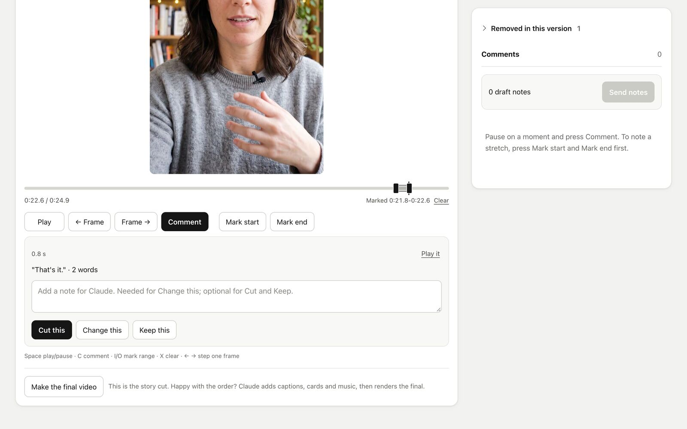<br>
<b>7. Watch and comment.</b> Mark a stretch and say Cut this, Change this or Keep this, with a
note. When the story is right, press Make the final video.</td>
<td>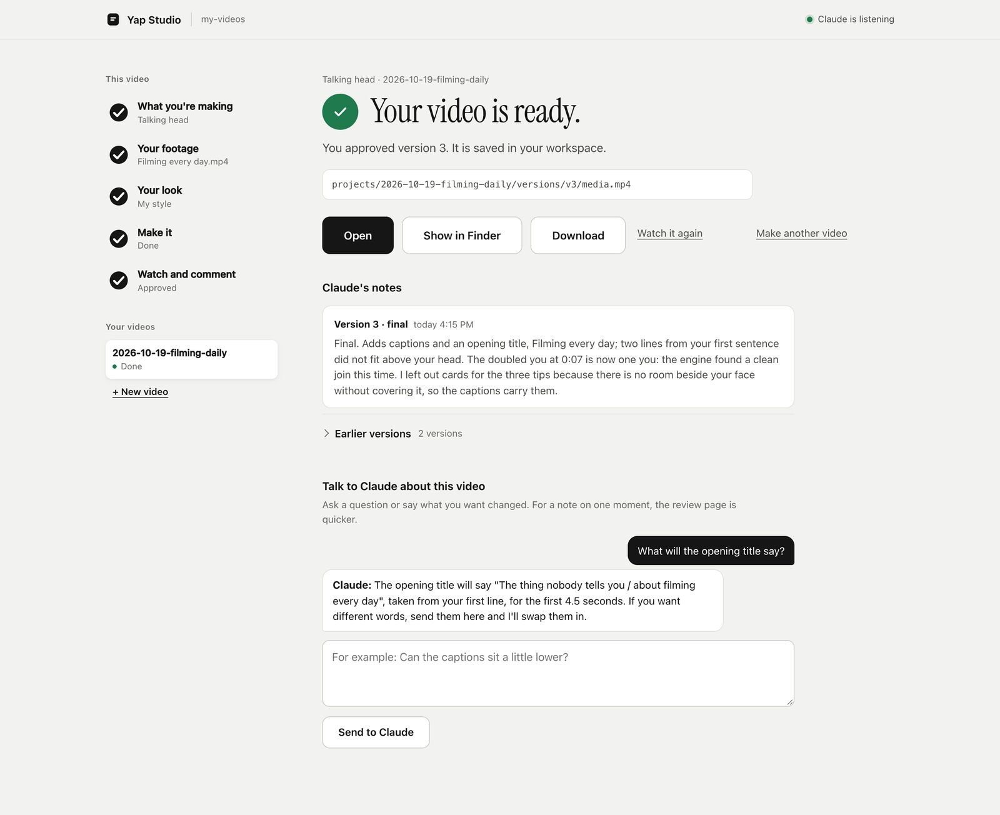<br>
<b>8. Done.</b> Approve the final, then open it on your Mac, show it in Finder, or download it.</td>
</tr>
</table>

<p align="center">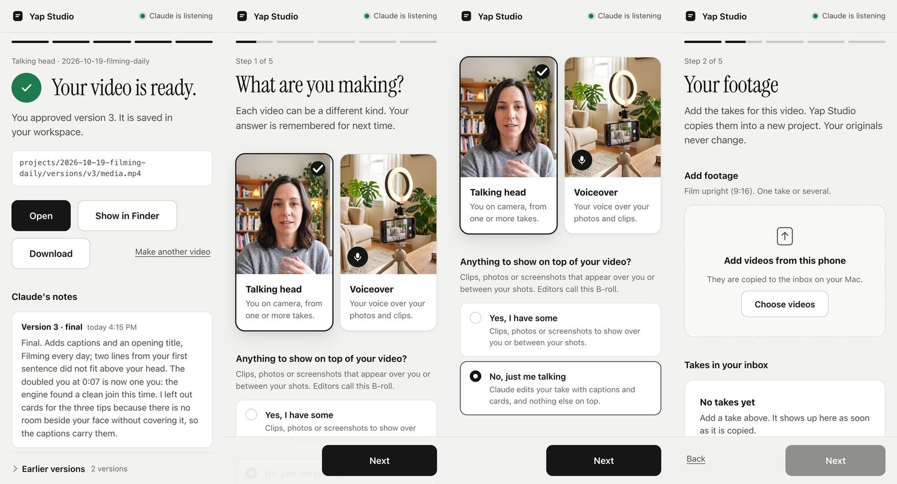</p>

The same pages work on a phone over the same Wi-Fi or Tailscale. Anything paid, such as
generated music, still goes through Claude in chat, and Claude asks first.

## Made with Yap Studio

- [How I use Tailscale](https://x.com/cathrynlavery/status/2105099276225307134): a talking-head
  video, edited end to end by the agent.
- [A cold plunge build](https://x.com/cathrynlavery/status/2110819344745923004): the first
  voiceover test, made from footage that sat in a camera roll since 2023.
- [The launch teaser](https://x.com/cathrynlavery/status/2108720117635022887).

Made something with it? Share it in [Discussions](https://github.com/cathrynlavery/yap-studio/discussions).

## What goes into the edit

- A story cut from your own words. Fillers, restarts and long pauses come out, and every join
  is checked for clicks and clipped words.
- Captions in your look: font, colours, highlight, one word at a time or whole phrases.
- Titles and more than two dozen kinds of cards (stats, quotes, checklists, steps, charts), each
  timed to the words it is about.
- Big words behind your head, cut around your outline, or a page, screenshot or clip behind
  you for a stretch (macOS).
- B-roll from your own photos and clips, cut in while you talk about them. Stock clips only if
  you turn them on, and only the ones you approve.
- Music from your own track, or composed with your
  [ElevenLabs](https://littlemight.com/recommend/elevenlabs) account (affiliate link) once
  you approve it.
- Sound effects on cuts, cards and counts, kept under your voice. They are made on your
  computer with no account, or come from your own ElevenLabs kit.
- Captions and cards that stay off your face. When faces were measured, a final that covers
  them fails its check. Otherwise, verify reports face clearance as "not measured".
- Phone review with comments pinned to a frame, a range or a spot on the picture, and versions
  side by side with earlier comments carried over.

## Your notes become your taste

After each round, the agent suggests rules from your notes. You approve, edit or reject each one.
Yap Studio enforces some of those rules itself. The agent follows the rest:

- **Yap Studio applies and checks:** how captions, titles, cards, B-roll and music look, and
  keeping text off your face. These apply to every later video unless you ask for something
  different on one video, and the final's checks measure the ones they can.
- **The agent follows, unchecked:** pacing, filler words and anything written as free text.
  The agent reads them when it plans the edit. Nothing changes the cut automatically, and
  nothing checks that it followed them.

It can also learn a style from videos you already posted.
[Styles and taste rules](docs/styles.md#taste-rules) has the details.

## It gets better from real use

When the agent struggles, it writes a one-line note about the tool: a step that failed, a doc
that was wrong, a check that missed something. With your OK, those notes become issues on this
repo, and that is how Yap Studio gets better.

Nothing private is shared. A note carries the agent's sentence, the step, the error code and the
Yap Studio and macOS versions, never your footage, your words, names, file names or paths. You
can read every note before it goes, or turn sharing off. [Feedback](docs/feedback.md) has the
details.

## Checked before you see it

Every render is checked before anyone watches it. Verify looks at every join for clicks, gaps,
broken words and wrong frames, and at picture and sound sync, frame and sample counts, loudness,
black or frozen picture, and the published rules for YouTube, Shorts, TikTok and Reels.

Source comparisons for sync, joins and expected frame and sample counts need an edit list
(`--edl`); platform rules need `--platform`. Checks that listen for words at joins or compare
captions with heard speech need a speech engine.

It works without the editor too. Point it at any finished video:

```console
yap-studio verify final.mp4
yap-studio verify final.mp4 --edl edits/cut.json --platform youtube
```

On its own, verify needs only ffmpeg 6.1 or newer. Findings, fixes, exit codes and the JSON
report are in [docs/verify.md](docs/verify.md).

## How it works

<p align="center">
</p>

Your speech is transcribed on your computer, word by word. The agent reads the transcript and
picks the story. It keeps your words and your meaning and makes nothing up. HyperFrames draws
the captions, titles and cards, and Yap Studio assembles and verifies the video before it reaches
your phone. Each round of comments makes a new version.

## Four kinds of video

The home page asks for a talking head or a voiceover. For the other two, tell Claude in chat.

- Talking head, from one or more takes to camera. That is the quick start above.
- Voiceover, from a voice memo and your own photos and clips of a project or a day. This one
  is early and still being built. See [docs/recipes/voiceover.md](docs/recipes/voiceover.md)
  and [the first test](https://x.com/cathrynlavery/status/2110819344745923004).
- Green screen, with you cut out over a page, screenshot, photo or clip that fills the frame
  (macOS). You can sit full size, along the bottom or in a corner. See
  [the workspace guide](workspace/CLAUDE.md#what-are-you-making).
- Screen recording, with your screen as the picture and your voice recorded with it or in a
  separate memo. You in a corner over the screen is not in this version yet.

## For developers

Yap Studio is a Python engine with a command line, so any agent that runs shell commands, Codex
included, can drive it. Every stage writes a receipt.

```console
git clone https://github.com/cathrynlavery/yap-studio.git
cd yap-studio
brew install uv ffmpeg node@22
uv tool install '.[asr,mcp]'
yap-studio renderer install
yap-studio speech download
yap-studio doctor --edit
```

You need Python 3.11 or newer, [uv](https://docs.astral.sh/uv/), ffmpeg 6.1 or newer and
Node.js 22 or newer.
To build the workspace zip from a checkout, run `uv run python scripts/build_workspace.py`. It
writes `dist/yap-studio-workspace-<version>.zip`. [docs/install.md](docs/install.md) has the full
requirements, the zip builder, and plugins for Claude Code, Codex and Claude Desktop. To run each
step yourself, see [docs/editing.md](docs/editing.md).

## Version 1 limits

- Vertical 9:16 at 1080 by 1920 stays the default. New horizontal talking-head videos at
  1920 by 1080 support hard cuts and captions: use `init DIR --take FILE --shape horizontal`.
  Titles, cards, B-roll, zooms, effects, grades, taste preferences, covers and studio exports
  are not supported horizontally yet; use platform `youtube` or `none`.
- The filler and restart rules are English only. For other languages, `fillers` proposes
  pauses only.
- Person cutouts, face detection and backgrounds behind you need macOS with the Xcode command
  line tools.

The rest, and what Yap Studio never judges, is in [docs/limits.md](docs/limits.md).

## Docs

- [Install](docs/install.md): requirements, source install, the workspace zip, plugins, updates.
- [Yap Studio home](docs/home.md): the guided page, and how its buttons reach the agent.
- [Edit from the command line](docs/editing.md): the steps the agent runs, by hand.
- [Commands](docs/commands.md): every command, the project commands and timeline lanes.
- [Captions, titles and cards](docs/captions-and-cards.md)
- [Music, sound effects and loudness](docs/audio.md)
- [Styles and taste rules](docs/styles.md)
- [The style page](docs/style-page.md): each screen, saving, and learning a style from videos
  you already posted.
- [Review](docs/review.md): the review page, phone links, keys and exported feedback.
- [Feedback](docs/feedback.md): local product notes, consent and sharing.
- [Verify](docs/verify.md): what it checks, findings, the JSON report and exit codes.
- [Edit lists](docs/edit-lists.md): the formats verify reads.
- [Limits](docs/limits.md)
- [How it works](docs/how-it-works.md): the engine, receipts and a map of the code.
- [Changelog](CHANGELOG.md)

## Contributing

Pull requests are welcome. [CONTRIBUTING.md](CONTRIBUTING.md) lists the local checks to run
first. Report security issues privately through [SECURITY.md](SECURITY.md), and follow the
[code of conduct](CODE_OF_CONDUCT.md).

## License

Copyright 2026 Cathryn Lavery.

Yap Studio is licensed under the Apache License 2.0; see [LICENSE](LICENSE). Bundled
third-party code and fonts keep their own licenses, listed in [NOTICE](NOTICE) and
[LICENSES/](LICENSES).
